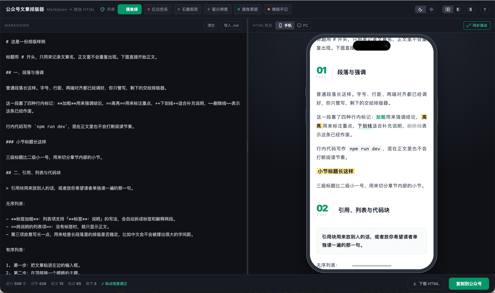

# 公众号文章排版器 · gzh-design

Markdown 贴进去，右边直接看到它在手机里的样子，点一下复制，粘到公众号编辑器里就是排好版的效果。

**不用跑 AI，不用联网，不传一个字。**



---

## 项目简介

一个单文件、零依赖、零构建的公众号排版工具。它把「排版规则」从 AI 提示词里抽出来，写成确定性的模板代码——同样的输入永远得到同样的输出，不用等模型，也不会跑偏。

| 能力 | 说明 |
|---|---|
| 粘贴即排版 | 左边贴 Markdown，右边 100ms 内出效果 |
| 六套主题 | 摸鱼绿 / 红白色系 / 石墨极简 / 留白禅意 / 摸鱼票据 / 橄榄手记 |
| 双预览 | 手机（375px 真机宽度）/ PC（677px 桌面微信阅读宽度） |
| 一键复制 | 写 `text/html` + `text/plain` 双 MIME，粘到公众号样式不丢 |
| 下载归档 | 导出独立 HTML 文件，文件名带时间戳 |
| 纯本地 | 文章只存在浏览器 localStorage，没有后端 |

适合：经常发公众号、又不想每次手动调字体行距的人；也适合把一篇 Markdown 快速变成能发的稿子。

> 六套主题的排版规则来自开源技能 [isjiamu/gzh-design-skill](https://github.com/isjiamu/gzh-design-skill)（AGPL-3.0），本项目是它的衍生作品，同样以 AGPL-3.0-or-later 发布——把「AI 技能」做成了不依赖模型的粘贴即排版工具。

---

## 快速使用

### 1. 打开

```bash
# 方式 A：直接双击 index.html（推荐 Chrome / Edge）
open index.html

# 方式 B：起个本地服务器（剪贴板 API 在 file:// 下偶尔被拦，用这个最稳）
npm start            # 等价于 python3 -m http.server 5173 --bind 127.0.0.1
# 然后打开 http://127.0.0.1:5173
```

第一次打开会自动装一份示例文章，把全部语法都演示了一遍——直接在里面改，或者全选删掉换成自己的。

### 2. 贴文章

把 Markdown 粘进左栏。只认一小套自建语法（见下方「支持的语法」），不需要记复杂规则：

~~~md
# 文章标题（不渲染，只用来记文章名 / 下载文件名）
## 一、章节标题（自动编号）
### 小节标题
普通段落
**加粗**  ==高亮==  ++下划线++  ~~删除~~  `行内代码`
> 引用
- 无序列表
1. 有序列表
``` 代码块 ```

---
~~~

### 3. 挑主题

顶部一排是风格，点一下即时换；右上角还能切**深色 / 浅色**界面（只影响工具本身，不影响导出结果）。

### 4. 复制到公众号

点右下角 **复制到公众号**，然后到公众号编辑器里 ⌘V。
如果浏览器拦了剪贴板，会提示你在预览区 ⌘A 全选后 ⌘C——效果一样。

### 5. 需要留档就下载

点 **下载 HTML**，得到 `公众号文章-20261023-090507.html`（年月日-时分秒），白底、677px 居中，可以直接存档或发人。

---

## 支持的语法

不引第三方解析器，自己实现了这一套：

| 写法 | 渲染结果 |
|---|---|
| `# 标题` | 不渲染，只当文章名（下载文件名也用它） |
| `## 章节` | 章节标题，自动编号，六套主题各有各的排法 |
| `### 小节` | 小节标题（左竖条 / 荧光底，跟主题走） |
| `**加粗**` `==高亮==` `++下划线++` `~~删除~~` | 四种行内标记，可混排 |
| `` `代码` `` | 行内代码 |
| `> 引用` | 引用块 |
| `- 列表` / `1. 列表` | 无序 / 有序列表，支持 `**标签**：说明` 拆成两层 |
| 三个反引号 + 语言名 | 围栏代码块，逐行渲染，不用 `white-space:pre` |
| `` | 独占一行的图片 + 图注 |
| `---` | 分割线 |

链接 `[文字](地址)` 只保留文字——公众号正文外链点不动，留着没意义。

---

## 六套主题

| key | 名称 | 章节标题 | 列表 | 引用 |
|---|---|---|---|---|
| `green` | 摸鱼绿 | 28px 大数字 + PART + 竖线 | 绿胶囊 + 说明行 | 绿色虚线圆角框 |
| `red` | 红白色系 | 红底圆角编号块 + 英文标签 | 红胶囊 + 说明行 | 淡红底 + 左竖条 |
| `graphite` | 石墨极简 | 48px 浅灰超大编号 + 细底线 | 灰胶囊 + 说明行 | 浅灰底 + 左竖条 |
| `zen` | 留白禅意 | 英文标签 + 衬线中文 + 短线 | 细线行 | 细线左竖条 |
| `ticket` | 摸鱼票据（默认） | 绿底实心方块 + 黑描边底线 | 绿方块卡片（方块定高 36px） | 淡绿底 + 深绿竖条 |
| `olive` | 橄榄手记 | 墨色编号 + PART + 竖线 | 灰胶囊 + 橙点 | 浅底 + 橙竖条 |

不是「一套结构换六个颜色」：章节标题、列表、引用、小节标题、末章都是各主题自己的一套。

---

## 界面速查

| 位置 | 功能 |
|---|---|
| 顶部左侧 | 风格（六套主题），前面的调色盘只是装饰 |
| 顶部右侧 | 界面深/浅色 · 双栏/只左/只右 · 帮助 |
| 左右分栏 | 中间竖线可拖动改宽度，双击回到等分 |
| 右栏标签栏 | HTML 预览（手机 / PC）· 同步滚动 · 回到顶部 |
| 左下角 | 中英文章节统计 · 标点检查 |
| 右下角 | 下载 HTML · 复制到公众号 |

- **同步滚动**默认开启：按进度百分比映射，不是逐行对齐（源码和渲染结果本来就不对应），长文会有可见漂移，属预期。
- 正文、主题、栏位、预览模式、同步开关、左栏宽度、界面配色**全部记在 localStorage**。
- 窗口窄于 820px 时自动改成上下堆叠。
- 没有缓存且编辑框为空时，自动装回示例。

---

## 项目结构

```
gzh-design/
├── index.html          # 全部代码：解析 / 渲染 / 界面 / 复制 / 下载
├── LICENSE             # AGPL-3.0（含上游版权声明与修改说明）
├── NOTICE              # 衍生作品声明：哪些沿用上游、哪些是本项目重写
├── examples/
│   ├── sample.md       # 一篇真实文章，看密度用
│   └── fixture.md      # 覆盖全部语法的测试样本
├── tools/test.js       # 无浏览器跑的逻辑测试（结构断言 / 缓存 / 布局 / 统计）
├── ui/                 # 六套主题的效果参考图（样式对齐用）
├── docs/
│   ├── PRD.md          # 产品说明：目标、功能、交互、验收标准
│   └── screenshot.png  # 界面截图（README 首图）
└── out/                # npm test 生成的六份主题 HTML（可删，已 gitignore）
```

---

## 四条实现约束

改渲染代码前先看这四条，破了任意一条就白干：

1. **每个文本节点必须包 `<span leaf="">`** —— 公众号靠这个标记接管文本样式，漏一个那一整段样式就没了。
2. **颜色必须写死在输出里** —— 公众号不认 `var()`，所以主题切换是重拼字符串，不是换 CSS 类。
3. **不能出现 `<div>` / `class` / `id` / `position`** —— 会被过滤，顺带弄坏布局。全部 `<section>` + 内联样式。
4. **每个块的 `<section>` 必须成对闭合** —— 漏一个闭合，解析器会把后面所有块当成子节点，`padding` 层层累加，正文越往下越窄（踩过：335px → 15px）。静态标签计数是配平的，只有按 DOM 祖先链数层数才看得出来，`npm test` 里用 `padDepthAudit()` 卡这条。

---

## 开发与测试

```bash
npm test        # node tools/test.js
```

会跑：六套主题生成 → 结构断言（每块只有 1 层内边距）→ 结尾引导 → 示例语法覆盖 → 单栏布局 → 字数统计 → 输出红线（无 div/class/id/absolute）→ 缓存往返 → 视图状态 → 缩放与机身高度 → 下载命名 → 界面配色。

合规校验（六套主题必须 0 ERROR / 0 WARNING）：

```bash
python3 ~/.agents/skills/gzh-design/scripts/validate_gzh_html.py out/theme-ticket.html
```

---

## 致谢与许可

本项目是 [isjiamu/gzh-design-skill](https://github.com/isjiamu/gzh-design-skill) 的**衍生作品**：

- **上游**：gzh-design-skill — 微信公众号排版技能，Copyright (C) 2026 甲木 (Jiamu) × 摸鱼小李 (Moyu Xiaoli)，AGPL-3.0-or-later
- **沿用**：六套主题的视觉规则与配色、章节标题/胶囊列表/票据卡/引用/代码块/结尾卡等组件结构、公众号 HTML 的书写约束
- **改写**：把「供 AI agent 调用的技能」做成不依赖模型的单文件静态工具——确定性输出，不经模型；并重写了 Markdown 解析、界面层、测试与校验

因此本项目同样以 **GNU AGPL-3.0-or-later** 发布，详见 [LICENSE](LICENSE) 与 [NOTICE](NOTICE)。

> 说明：AGPL 只约束这份工具的代码。你用本工具排出来的文章，版权仍然是你自己的。

## License

[GNU Affero General Public License v3.0 or later](LICENSE)（AGPL-3.0-or-later）

